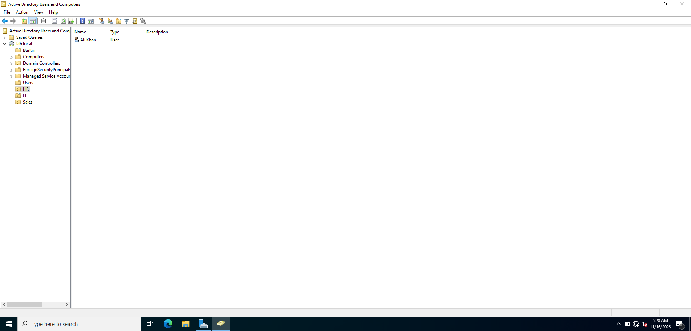
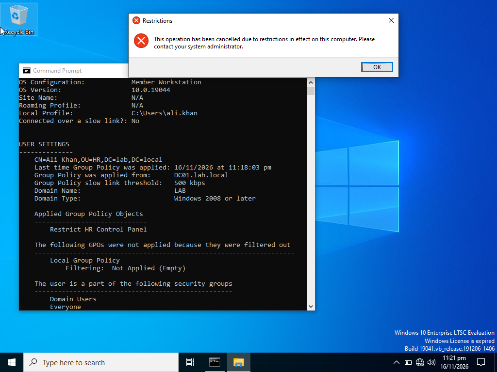
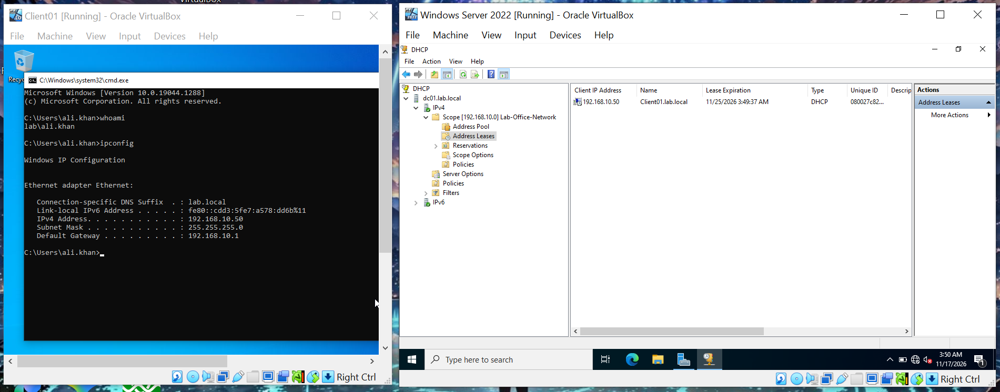
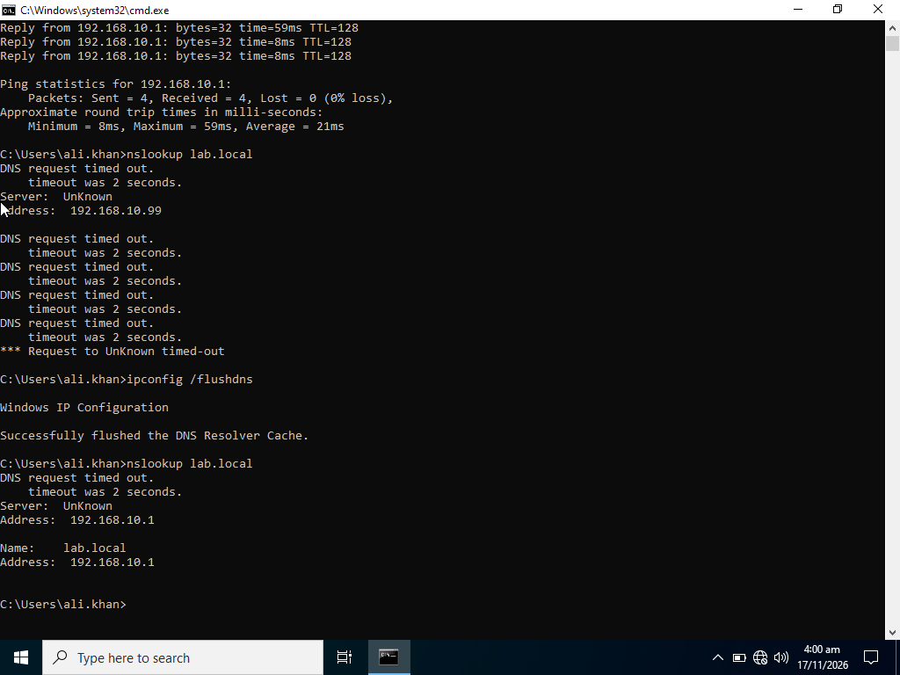
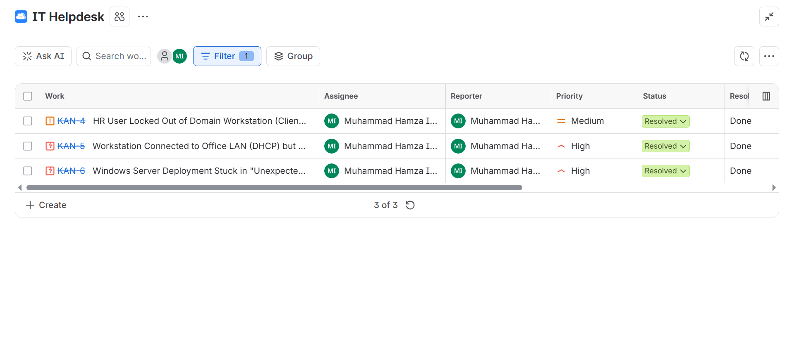
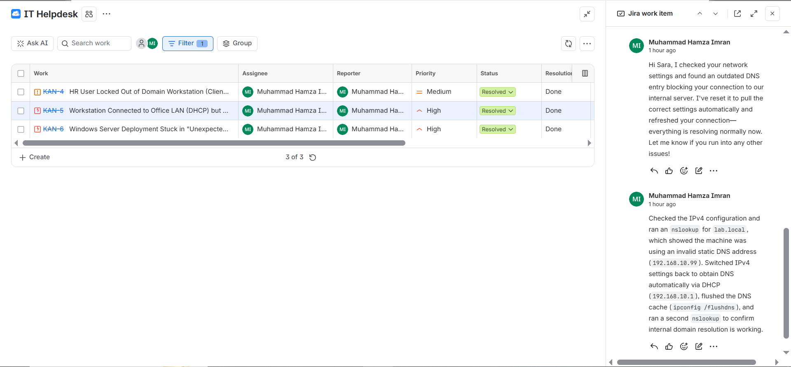

# 🖥️ Enterprise IT Support & Systems Administration Home Lab

A hands-on virtualized corporate IT environment built to demonstrate Tier
1/Tier 2 Help Desk operations, Active Directory administration, network
diagnostics, and incident documentation.
## 🛠️ Lab Architecture & Tools
* **Hypervisor:** Oracle VirtualBox (Isolated Internal Network
`192.168.10.0/24`)
* **Domain Controller (`DC01`):** Windows Server 2022 Standard (AD DS, DNS,
DHCP, GPO)
* **Client Workstation (`Client01`):** Windows 10 Enterprise LTSC
* **Diagnostic & Ticketing Tools:** `ipconfig`, `nslookup`, `gpupdate`,
`gpresult`, `regedit`, Jira Service Management
---
## 📂 Lab 1: Active Directory & Group Policy Management
* **Tasks Completed:** Promoted `DC01` to root forest (`lab.local`),
structured departmental Organizational Units (`HR`, `IT`, `Sales`),
provisioned employee accounts, joined `Client01` to the domain, and deployed a
GPO restricting Control Panel access for HR users.
* **Key Troubleshooting:** Resolved an initial GPO filtering issue by
verifying user OU placement and forcing policy updates via `gpupdate /force`
and `gpresult /r`.

---
## 🌐 Lab 2: DHCP Automation & DNS Incident Resolution
* **Tasks Completed:** Configured an automated DHCP scope (`192.168.10.50–
100`) on `DC01` and migrated `Client01` from static IP to dynamic leasing.
* **Simulated Incident:** Diagnosed a broken internal name resolution ticket
where IP pings succeeded but domain lookups failed. Identified a misconfigured
DNS server entry via `nslookup`, restored DHCP DNS, and cleared local cache
with `ipconfig /flushdns`.

---
## 🎫 Lab 3: Help Desk Ticketing & Incident Documentation
* **Tasks Completed:** Simulated end-to-end Tier 1 ticket triage, SLA
prioritization, root-cause logging, and non-technical customer communication
across account lockout, DNS failure, and OS registry recovery tickets.

